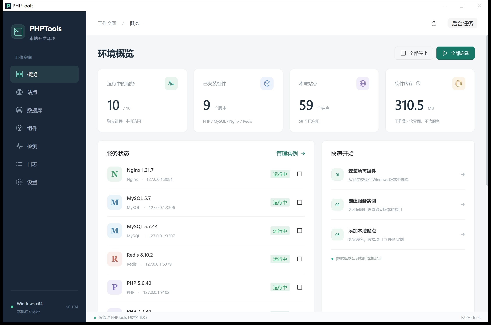
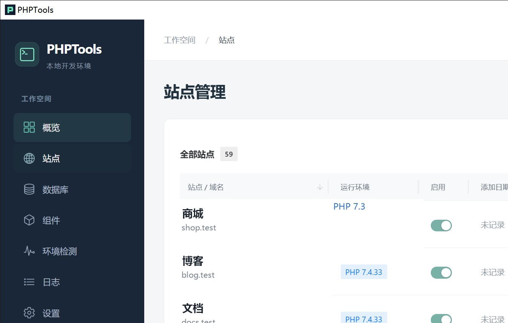
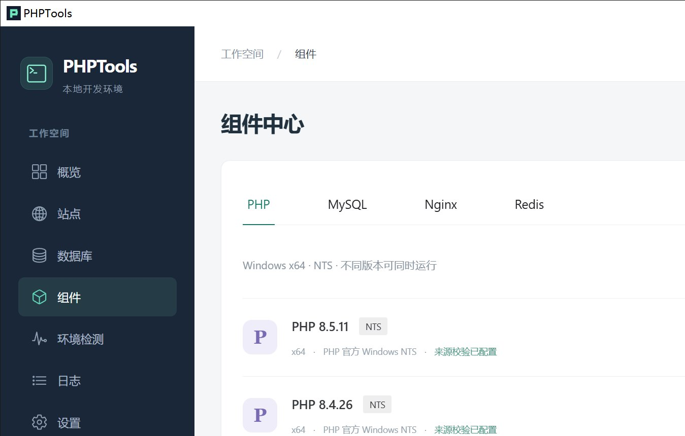

# PHPTools

Windows 上的本地 PHP 开发环境。在一个窗口里管理 Nginx、PHP、MySQL 和 Redis。

站点、数据库和密码留在你自己的电脑上。组件按需下载，升级只替换软件本身。

官网：https://phptools.wuyouzhilian.cn

下载：https://phptools.wuyouzhilian.cn/PHPTools.exe

## 界面

概览里看服务和已安装的组件。

站点页管理本地域名和项目目录。

组件中心按需安装 PHP、MySQL、Nginx 和 Redis。

## 开始使用

1. 从官网下载 Windows 版，解压后运行 `PHPTools.exe`。
2. 选一个空目录保存环境，例如 `D:\PHPTools`。
3. 安装需要的组件，启动服务，再添加站点。

需要 Windows 10/11 64 位，以及 Microsoft Edge WebView2。第一次打开时的步骤见 `FIRST_RUN.md`。开发和打包的详细说明见 `docs/REFERENCE.md`。
